# 파우치 평가 성분 미리보기

실제 제품 상세·평가 시트 컴포넌트에 고정 API 응답을 연결한 모바일 검증 화면입니다. 기본 화면은 412×915이며, 짧은 화면·큰 글자·움직임 줄이기 조건을 별도로 포함합니다. 실제 사용자 계정이나 평가를 수정한 촬영은 아닙니다.

괜찮았던 성분은 최종 크기만큼 흰 공간 확보 → 초록 박스 250ms 펼침 → 650ms부터 180ms 간격으로 성분 등장 순서입니다. 기존 종료 시각은 유지합니다.

| 상황 | GIF |
| --- | --- |
| 01. 비로그인 · 피부타입 없음 · 첫 안 맞았어요 · 새 성분 |  |
| 02. 비로그인 · 피부타입 없음 · 기존 평가 있음 · 개수 증가와 새 성분 |  |
| 03. 비로그인 · 피부타입 없음 · 잘 맞았어요 · 일부 성분 제외 | 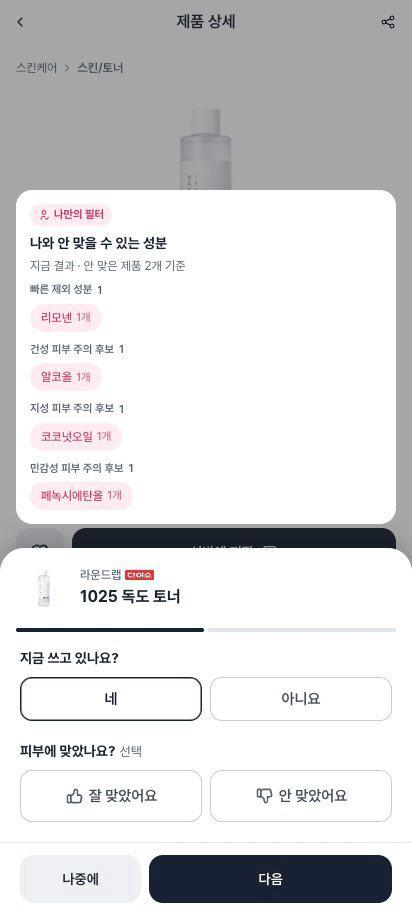 |
| 04. 비로그인 · 피부타입 없음 · 잘 맞았어요 · 전체 성분 제외 |  |
| 05. 비로그인 · 피부타입 없음 · 빠질 후보 없음 · 괜찮았던 성분 순서대로 추가 |  |
| 06. 비로그인 · 피부타입 없음 · 주의 성분 없음 · 기존 결과 유지 |  |
| 07. 비로그인 · 피부타입 없음 · 선택 후 해제 |  |
| 08. 비로그인 · 피부타입 없음 · 잘 맞았어요 → 안 맞았어요 |  |
| 09. 로그인 · 피부타입 미등록 · 첫 안 맞았어요 · 새 성분 |  |
| 10. 로그인 · 피부타입 미등록 · 기존 평가 있음 · 개수 증가와 새 성분 |  |
| 11. 로그인 · 피부타입 미등록 · 잘 맞았어요 · 일부 성분 제외 |  |
| 12. 로그인 · 피부타입 미등록 · 잘 맞았어요 · 전체 성분 제외 |  |
| 13. 로그인 · 피부타입 미등록 · 빠질 후보 없음 · 괜찮았던 성분 순서대로 추가 |  |
| 14. 로그인 · 피부타입 미등록 · 주의 성분 없음 · 기존 결과 유지 |  |
| 15. 로그인 · 피부타입 미등록 · 선택 후 해제 |  |
| 16. 로그인 · 피부타입 미등록 · 잘 맞았어요 → 안 맞았어요 | 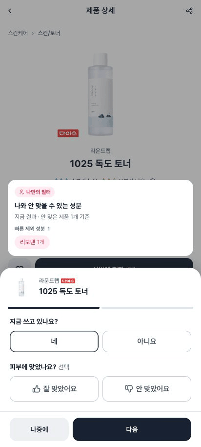 |
| 17. 로그인 · 피부타입 등록(건성) · 첫 안 맞았어요 · 새 성분 | 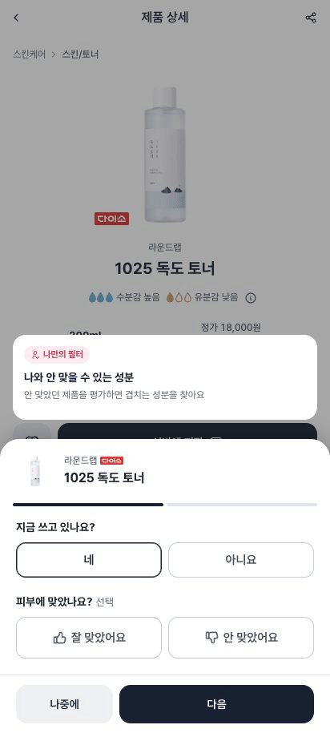 |
| 18. 로그인 · 피부타입 등록(건성) · 기존 평가 있음 · 개수 증가와 새 성분 |  |
| 19. 로그인 · 피부타입 등록(건성) · 잘 맞았어요 · 일부 성분 제외 |  |
| 20. 로그인 · 피부타입 등록(건성) · 잘 맞았어요 · 전체 성분 제외 |  |
| 21. 로그인 · 피부타입 등록(건성) · 빠질 후보 없음 · 괜찮았던 성분 순서대로 추가 |  |
| 22. 로그인 · 피부타입 등록(건성) · 주의 성분 없음 · 기존 결과 유지 |  |
| 23. 로그인 · 피부타입 등록(건성) · 선택 후 해제 |  |
| 24. 로그인 · 피부타입 등록(건성) · 잘 맞았어요 → 안 맞았어요 |  |
| 25. 로그인 · 피부타입 미등록 · 피부 미등록 · 빠른 제외와 피부별 후보 혼합 |  |
| 26. 비로그인 · 피부타입 없음 · 같은 묶음 성분 8개 · 더보기 개수 |  |
| 27. 비로그인 · 피부타입 없음 · 빠른 선택 전환 |  |
| 28. 비로그인 · 피부타입 없음 · 응답 전 먼저 선택 | 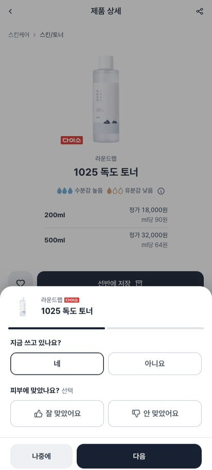 |
| 29. 비로그인 · 피부타입 없음 · 미리보기 API 실패 | 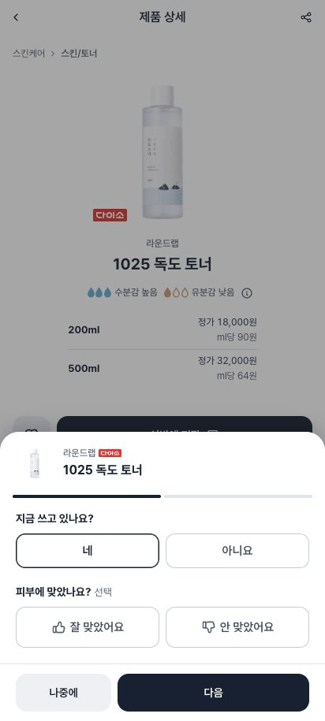 |
| 30. 비로그인 · 피부타입 없음 · 같은 제품 재진입 · 새 응답 실패 |  |
| 31. 비로그인 · 피부타입 없음 · 움직임 줄이기 |  |
| 32. 비로그인 · 피부타입 없음 · 짧은 화면 | 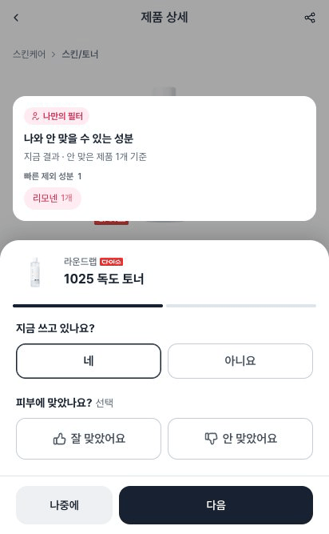 |
| 33. 비로그인 · 피부타입 없음 · 큰 글자 | 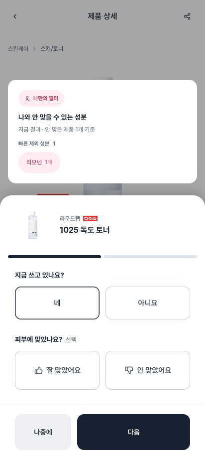 |
| 34. 비로그인 · 피부타입 없음 · 파우치 수정 · 잘 맞았어요 → 안 맞았어요 | 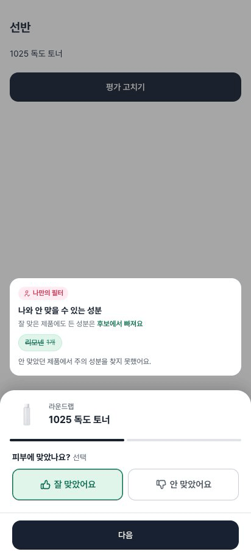 |
| 35. 비로그인 · 피부타입 없음 · 파우치 수정 · 안 맞았어요 → 잘 맞았어요 | 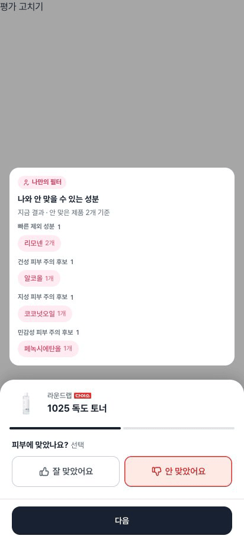 |
| 36. 로그인 · 피부타입 미등록 · 파우치 수정 · 잘 맞았어요 → 안 맞았어요 |  |
| 37. 로그인 · 피부타입 미등록 · 파우치 수정 · 안 맞았어요 → 잘 맞았어요 | 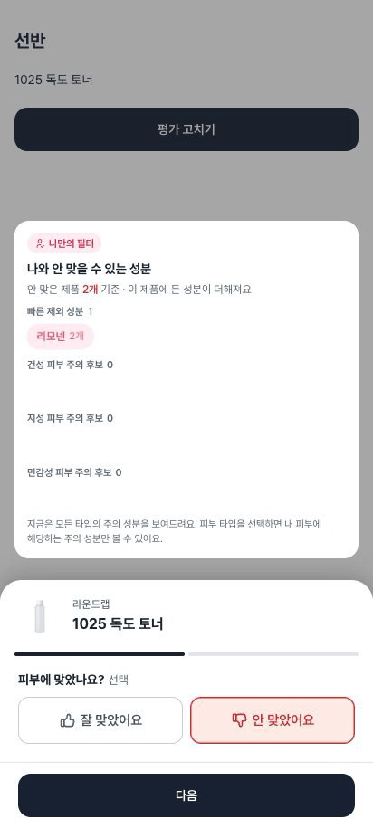 |
| 38. 로그인 · 피부타입 등록(건성) · 파우치 수정 · 잘 맞았어요 → 안 맞았어요 |  |
| 39. 로그인 · 피부타입 등록(건성) · 파우치 수정 · 안 맞았어요 → 잘 맞았어요 | 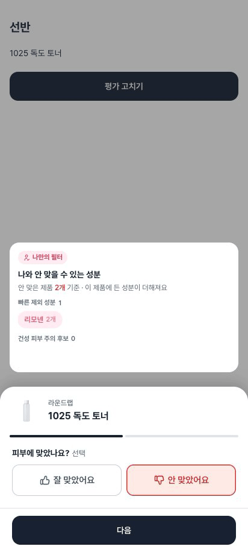 |
