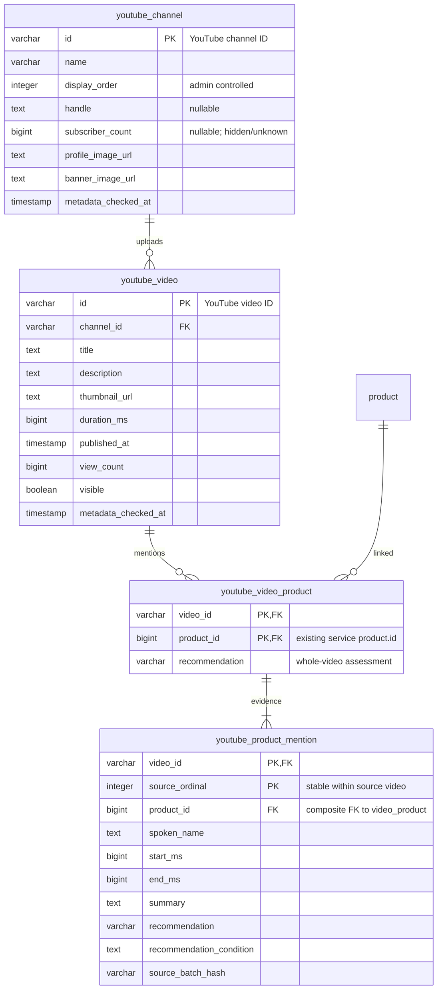

# 유튜버 제품 시범 기능: 서비스 DB·API·화면

## 범위와 현재 상태

2026-11-05 사용자 정정: 데이터허브에서 필터링한 JSON 생성은 서비스 기능 구현이 아니다.
운영 서비스 PostgreSQL에 관계를 저장하고, 이 저장소의 API와 화면이 해당 DB를 읽어야 한다.
데이터허브는 원본·후보·누락·검수 근거를 보존한다. 서비스 런타임은 데이터허브/API/로컬 JSON에
의존하지 않는다. 소비자 화면은 사용자가 제공한 홈·목록·제품·영상 스크린샷을 기준으로 구현한다.

확인한 구현: Spring MVC/JdbcTemplate/PostgreSQL, Flyway migration, Controller → Service →
Repository 경계와 OpenAPI 기반 프론트 타입 생성이 있다. 이슈는
[#1106](https://github.com/woowacourse-teams/2026-poudy/issues/1106), 작업 브랜치는
`feat/1106-youtube-pilot`이며 최신 `dev`의 V57을 기준으로 시작했다.

현재 구현: V58의 4개 테이블, 조회 API, 관리자 Order API/화면, 홈 섹션,
유튜버 목록과 상세 제품/영상 2개 탭을 추가했다. 영상 탭은 작은 프로필과 이름을 헤더로
표시한다. 제품 필터·타임스탬프 재생·현재 제품 상세 링크가 연결되어 있다.
별도 로컬 PostgreSQL18에 4채널·5영상·13제품·14발언을 반입했다.
운영/스테이징 DB에는 적용하지 않았다.

## 확정된 제품 정책

- 서비스에 실제 존재하는 제품에 확정 연결된 항목부터 시범 노출한다.
- 시각 ±3초 미검수는 이번 시범 노출을 막지 않는다. 사람 검수가 끝난 것으로 표시하지 않는다.
- 누락·불명확한 제품은 데이터허브 기록으로 남긴다. 추정 이름으로 서비스 제품을 만들지 않는다.
- 발언명과 서비스의 정식 제품명을 분리한다. 정식명·이미지는 현재 `product`/`brand`에서 조회한다.
- 비추천·혼합·중립·불확실은 정보성 언급으로 표시한다. 명확한 추천만 제품당 영상별1회 집계한다.
- 같은 영상의 같은 제품에 추천/비추천이 섞이면0회다. 표시하지 않는 구간 때문에 추천으로
  잘못 집계되지 않도록 영상–제품 전체 평가를 적재 단계에서 함께 전달한다.

## 서비스 ERD 초안

`youtube_video_product`는 영상–제품의 중복 없는 연결 및 전체 평가를 보관하고,
`youtube_product_mention`은 반복 발언별 시각·요약·조건을 보관한다. 제품이 영상에서 여러 번
나와도 추천 횟수는 연결 테이블의 명확한 추천 영상 수다. 집계 테이블/캐시는 처음에는 만들지
않고 채널·제품별 SQL 집계로 계산한다. 평가값은 recommended / not_recommended / mixed /
neutral / uncertain으로 제한한다. 상세 발언과 전체 평가는 동일 적재 트랜잭션에서 검증한다.

영상 ID+제품 ID는 유일해야 한다. 발언은 연결된 영상/제품 쌍에만 속할 수 있어야 한다.
시각은 음수가 아니며 시작<종료≤영상 길이인지 적재 시 검증한다. 서비스에 미등록된 제품은
외래 키와 이름/브랜드 대조로 거부한다. 허브와 서비스의 숫자 ID가 같다는 사실만 믿지 않는다.

## 개발 순서

1. 대상 배포 DB의 실제 schema/Flyway 이력을 확인하고 현재 서비스 브랜치와 대조한다.
   로컬 checkout의 마지막 migration 번호를 확인 없이 운영에 적용하지 않는다.
2. 추가형 migration과 위 관계의 저장/조회 테스트를 구현한다. 기존 제품/사용자 테이블을
   재구성하거나 제품을 생성하지 않는다.
3. 고정된 데이터허브 배치 → 서비스 반입 도구를 만든다. 제품 ID·브랜드·이름 대조, 시각 범위,
   중복, 전체 평가를 검사하고 원자적 적재·재실행 무중복·실패 롤백을 검증한다. 수정 시
   선택 영상 범위만 교체하며 다른 영상/과거 원본을 임의 삭제하지 않는다.
4. 서비스 DB를 읽는 API와 OpenAPI 생성 타입을 구현한다. 후보 경로:
   - `GET /api/youtube/channels`: 표시할 영상/제품이 있는 채널 목록
   - `GET /api/youtube/channels/{channelId}/videos`: 해당 채널 영상·연결 제품·발언 구간
   - `GET /api/products/{productId}/youtube-mentions`: 제품별 관련 영상·요약·추천 여부
   채널–제품의 추천 영상 수를 응답에 포함한다. 최근 1년의 공개 영상만 조회/집계한다. 페이지 크기는 제한하며 숨긴 영상과 빈 채널을
   제외한다. 제품 목록과 단일 채널 API, 관리자 Order 조회/수정 API도 제공한다.
5. 동일 묶음으로 로컬 통합 검증 → 스테이징 migration/반입/API 검증 → 운영 사전 백업과
   migration/반입 순서로 진행한다. 실제 DB 적용과 서비스 공개는 각각 결과를 기록한다.
6. 전달받은 화면 디자인 기반 홈의 유튜버 제품 섹션을 서비스 API에 연결한다. 기존 제품 상세 링크·YouTube
   원본 시각 링크를 사용하고 미등록 제품 자리표시를 만들지 않는다. 관련 캐시와 새 브라우저를
   확인한 뒤 공개 완료로 판단한다.

## 초기 반입 자료

데이터허브 중앙 배치:
`8d4a03c8552041c4be9073b7282b17861b293c0c2c94aedbe61981cd1a679b05`.
서비스 제품 API의 ID·브랜드·이름 대조를 마친 후보는4채널/5영상/13제품/14언급이다.
나머지209개 구간은 허브 내부 기록으로 보존했다. 이 숫자는 서비스 DB 적재 실적이 아니다.
반입 직전에 서비스 DB를 다시 대조한다. 원본 데이터·서비스 응답·비밀 값은 Git에 넣지 않는다.

## 완료 기준

- 기존 서비스 제품에만 연결, 제품/영상/발언 FK 및 중복 제약 통과.
- 반복 추천1회, 혼합/비추천0회, 정보성 스크립트 연결 유지, 빈 채널/영상 제외.
- 같은 반입 재실행 무중복, 실패 시 전체 롤백, 대상 외 기존 자료 보존.
- `sh ./scripts/verify.sh` 통과 및 OpenAPI/TypeScript 생성물 일치.
- 스테이징·운영 적재 영수증과 직접 API/공개 API/새 브라우저 결과를 별도로 기록.
- 홈 화면에서 실제 서비스 API를 사용하고 허브 관리자 JSON을 직접 호출하지 않음.

## UI 확정 사항

- 홈의 가로 채널 카드 → 전체 유튜버 목록 → 채널 상세.
- 채널 Order 오름차순, 같은 Order는 채널 ID 순. 홈과 목록이 같은 정렬을 사용한다.
- 제품 탭은 큰 프로필, 영상 탭은 뒤로가기·작은 프로필·유튜버 이름 헤더.
- 제품/영상 2개 탭만 구현한다. 기존 앱 전역 하단 내비게이션의 루틴은 변경하지 않는다.
- 횟수 표시는 `추천 n회`. 정보성 구간은 연결과 요약을 유지하지만 추천 집계에서 제외한다.
- 서비스 미등록 제품이나 등록 요청 자리표시는 이번 화면에 넣지 않는다.
- 전송/재실행 계약: [반입 도구 문서](../../../scripts/youtube/README.md).

## 검증 기록

- 스키마 17개 + 조회/집계/관리자 권한 15개 테스트 통과.
- nullable API 필드를 명시하고 생성물을 재생성한 뒤 전체 서버 verify.sh 통과(1,963개 테스트).
- 프론트 운영 빌드·타입 검사·변경 파일 린트 통과. 제품 필터/타임스탬프/혼합 평가/키보드 탭 및 관리자 순서 저장 테스트 3개 통과.
- 390px 모바일 브라우저에서 실제 채널과 제품, 영상 헤더, 13:10 시작 재생 확인.
- 재반입 무중복, COMMIT 직전 오류 시 롤백, 대상 DB 불일치 거부 확인.
- 기존 서비스 DB의 모든 *_at 필드는 한국 현지 timestamp 규칙이므로 새 테이블도 이를 따른다.
- 남은 작업: 리뷰/스테이징·운영 실제 migration 이력 확인, 백업, 반입, 배포 후 검증.

로컬 검수 화면·전송 JSON·반입 검증 영수증은 `/Users/k.seonwoo/.codex/artifacts/youtube-service-1106/`에 보관했다. Git에는 원본 콘텐츠를 포함하지 않는다.
