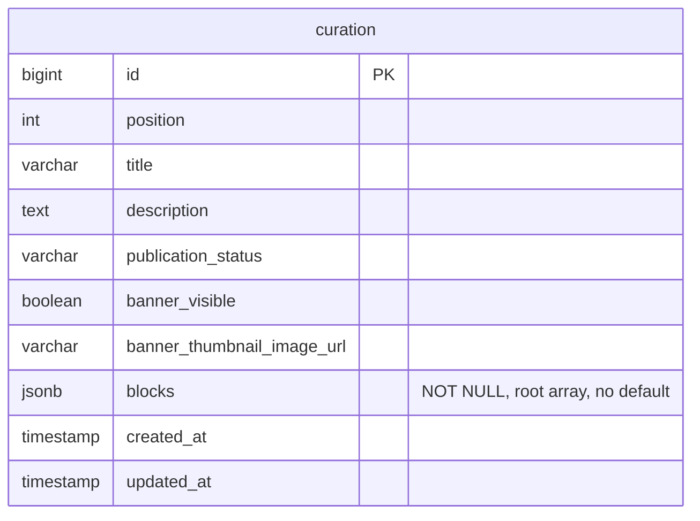

# 큐레이션 저장

큐레이션 메타데이터와 본문은 PostgreSQL의 한 행에 저장한다. 본문만 JSONB 문서로 관리하며,
제품명·가격·이미지 등 상품 응답은 복제하지 않고 공개 조회 시 현재 카탈로그에서 읽는다.
기존 목록·상세 API, 게시·배너 정책은 유지한다. PRODUCT_LINK는 조건에 맞는 제품 목록으로 이동한다.
사이트맵의 큐레이션 수정일도 JSONB의 제품 참조로 집계한다. 큐레이션과 참조 제품 중
가장 늦은 수정일을 사용하며, 없는 제품이 있으면 남은 데이터로 계산한다.

## DB 구조

아래는 전환 후 사용하는 저장 모델이다. JSON 내부 연결은 DB 외래 키가 아니다.

- `blocks`는 JSON 배열이어야 하며, 빈 본문은 명시적인 `[]`로 저장한다. SQL NULL과 JSON null은 거절한다.
- 블록·필터·제품·제품별 필터 ID의 배열 순서가 표시 순서다. 객체 키 순서는 의미가 없다.
- 본문 수정은 배열 전체를 교체한다. 메타데이터·게시 상태와 함께 바뀌면 같은 트랜잭션에서 갱신하고
  `updated_at`도 명시적으로 갱신한다. 자동 갱신 트리거는 없다.
- 문서 내부 검색과 버전 이력은 이번 범위에 없으므로 GIN 인덱스와 버전 테이블을 두지 않는다.

## 본문 계약

모든 블록은 `id`(UUID), `type`, `spacingTop`, `spacingBottom`을 갖는다. 여백은 0 이상의
32비트 정수다. 같은 큐레이션의 블록 ID는 중복될 수 없다.

| type | 추가 필수 필드 | 규칙 |
| --- | --- | --- |
| IMAGE | imageUrl, altText, bodyText | URL은 공백이 아니며 최대 1,000자. altText는 NULL 또는 최대 500자. bodyText는 NULL 허용 |
| PRODUCTS | productIds | 양수 64비트 정수 ID 배열. 중복 금지, 빈 배열 허용 |
| PRODUCTS_BY_FILTER | filters, products | 필터 최소 1개. 블록 내 필터 ID·제품 ID 중복 금지 |
| PRODUCT_LINK | label, query | 일반 텍스트 문구는 공백이 아니며 최대 100자. 검색 조건 최소 1개 |

문자열 길이는 유니코드 코드 포인트로 센다. 텍스트의 공백·줄바꿈·빈 문자열을 보존하며,
IMAGE의 `altText`/`bodyText` 키는 NULL이어도 반드시 넣는다.

필터는 `{ "id": "UUID", "label": "문구" }`이며 문구는 공백이 아니고 최대 100자다.
필터형 제품은 `{ "productId": 10, "filterIds": ["UUID"] }`이다. 각 제품의 filterIds는
이 블록에 있는 필터를 하나 이상 참조해야 하며 중복될 수 없다. products는 빈 배열을 허용한다.
필드 누락·알 수 없는 필드/타입·잘못된 자료형을 거절하고 숫자 문자열이나 소수 ID를 변환하지 않는다.

PRODUCT_LINK의 query는 `keyword`, `brandIds`, `categoryIds`, `includeIngredientIds`,
`includeGroupCodes` 다섯 필드를 모두 갖는다. 미지정 검색어는 NULL, 미지정 배열은 []로 적는다.
keyword는 기존 제품 검색과 같은 유효성 및 최대 100 UTF-16 코드 단위 규칙을 따른다.
각 배열은 최대 100개이며 중복을 허용하지 않는다. 참조 ID는 양의 64비트 정수,
성분군 코드는 공백이 아닌 문자열이다. 일반 제품 검색에는 배열 상한이 없지만, 편집하는
링크 문서에는 과도한 조회 조건과 URL 크기를 제한하기 위해 별도 상한을 둔다.
조건은 기존 제품 검색과 같은 AND 결합을 사용한다. 포함 성분은 모두 필요하고,
각 포함 성분군은 소속 성분 중 하나 이상을 포함해야 한다. 빠른 제외 성분군은 받지 않는다.
page, size, sort, href와 외부 URL은 저장하지 않는다.

## 검증 책임

현재 큐레이션 쓰기 API와 저장 서비스는 없다. 조회 시 Repository의 codec과 도메인이
문서 구조·필수 값·블록 내부 연결을 검증한다. 제품 ID의 존재는 현재 카탈로그 조회에서 해석한다.
제품 링크의 브랜드·카테고리·성분·일반 성분군 참조는 같은 상세 조회 트랜잭션 안에서
종류별로 한 번씩 조회한다. 제품 목록의 결과가 0개여도 유효한 조건이면 링크를 유지한다.

JSON 내부 제품 ID에는 FK가 없으므로 직접 SQL로 적재한 제품 참조가 항상 유효하다고
보장하지 않는다. 향후 저장·수정 기능을 구현할 때 해당 서비스에서 구조와 제품 참조를
저장 전에 검증한다. 참조 존재와 판매 상태는 구분한다. 별도 검증 CLI는 제공하지 않는다.

## 조회 오류

잘못된 문서는 큐레이션 ID를 포함한 인프라 오류로 처리한다. 빈 본문으로 대체하지 않는다.
구조가 유효하지만 상품이 없으면 기존 동작대로 없는 상품·빈 필터를 제외하고, 최종 상품이
없어진 제품 블록을 응답에서 제외한다. 누락 ID는 `curation_missing_product` 경고로 남기며
저장 문서를 자동 수정하지 않는다. DB 장애나 상품 조립 실패는 요청 실패로 처리한다.
제품 링크 참조가 없거나 빠른 제외 성분군이면 해당 블록 전체를 응답에서 제외하며,
`curation_invalid_product_link` 로그에 큐레이션·블록 ID와 참조 ID·코드를 남긴다.
무효 조건만 빼서 더 넓은 제품 목록으로 보내지 않는다. 참조 DB 장애도 요청 실패로 처리한다.

## 제품 링크 화면 이동

클라이언트는 PRODUCT_LINK의 query를 `EMPTY_FILTER`에 적용하고 기존 `serializeFilter`로
`/products?...` 링크를 만든다. 이전 화면의 검색 조건을 섞지 않고 첫 페이지·기본 정렬로 연다.
label은 HTML로 해석하지 않고 일반 텍스트로 렌더링한다. 새 조회나 리다이렉트 API는 없다.
서버와 클라이언트가 새 타입을 모두 지원한 뒤 실제 큐레이션 문서에 링크 블록을 추가한다.

백엔드 PR은 서버·공통 계약과 최소 클라이언트 호환 처리를 함께 포함한다. 이 단계의
클라이언트는 PRODUCT_LINK를 숨기고 SEO의 제품 집계에서 제외한다. 후속 프론트엔드
PR이 실제 버튼을 연결한다. 공통 생성 타입이 바뀌면 기존 클라이언트의 타입 검사도
실행되므로 서버·common만 먼저 머지할 수는 없다.

백엔드 PR은 서버·공통 계약과 최소 클라이언트 호환 처리를 함께 포함한다. 이 단계의
클라이언트는 PRODUCT_LINK를 숨기고 SEO의 제품 집계에서 제외한다. 후속 프론트엔드
PR이 실제 버튼을 연결한다. 공통 생성 타입이 바뀌면 기존 클라이언트의 타입 검사도
실행되므로 서버·common만 먼저 머지할 수는 없다.

## 두 번의 배포

첫 배포는 `V12__curation_blocks_jsonb.sql`이 담당한다. 기존 네 하위 테이블을 잠근 상태에서
본문을 순서대로 변환하고 NOT NULL/루트 배열 CHECK를 적용한다. 구버전 서버가 롤링 배포 중
읽을 수 있도록 네 테이블과 전용 트리거·함수는 남긴다. 새 서버는 JSONB만 읽는다.

이전 시작 전부터 모든 서버의 읽기 전환이 끝날 때까지 큐레이션 적재·수정·게시를 중지한다.
DB 잠금은 변환 중 동시 쓰기만 막으므로, 배포 전체의 쓰기 중지는 운영 절차로 지켜야 한다.
전환 뒤 JSONB 수정이 시작되면 legacy 데이터가 낡아 구버전 앱 롤백을 보장할 수 없다.

모든 서버가 JSONB를 읽고 운영 데이터의 이전 결과를 확인한 다음 **별도 배포**에서 제거한다.
제거는 `src/main/resources/db/migration/V13__remove_curation_legacy_tables.sql`이 담당한다.
V12의 운영 확인 후 별도 PR·배포로 적용하며, 서버 기동 때 Flyway 트랜잭션 안에서 실행한다.
구형 데이터로 본문을 다시 조립하지 않으므로 전환 후 수정된 JSONB와 PRODUCT_LINK도 유지된다.
현재 코드는 V13을 포함하지만 실제 staging·운영 제거 배포와 외부 ERD 반영은 별도로 확인한다.

두 번째 배포는 `curation_block_product_filter`, `curation_block_product`,
`curation_block_filter`, `curation_block` 순서로 제거하고 큐레이션 전용 함수 두 개를 제거한다.
다른 도메인도 사용하는 `require_contiguous_order`는 유지한다. 외부 ERD에서도 이 단계가
완료된 후 기존 테이블을 제거하며, JSON 내부의 제품 참조에 FK 관계선을 그리지 않는다.

배포 전 모든 서버가 JSONB를 읽는지 확인하고 직접 SQL 적재·수정 작업을 조율한다.
V13은 큐레이션 테이블을 ACCESS EXCLUSIVE로 잠그므로 장기 트랜잭션이 없는 시점에 적용한다.
배포 후 `flyway_schema_history`의 V13 성공, 네 테이블·전용 함수 두 개의 부재와 큐레이션
목록·상세·사이트맵 응답 및 오류 로그를 확인한다. 제거 후 앱 롤백은 현재 JSONB 문서 타입을
지원하는 버전으로 한정한다. 구형 테이블 조회 버전으로 되돌리지 않으며, DB 복원이 필요한
경우 배포 전 백업과 배포 후 변경분을 함께 복구해야 한다.
