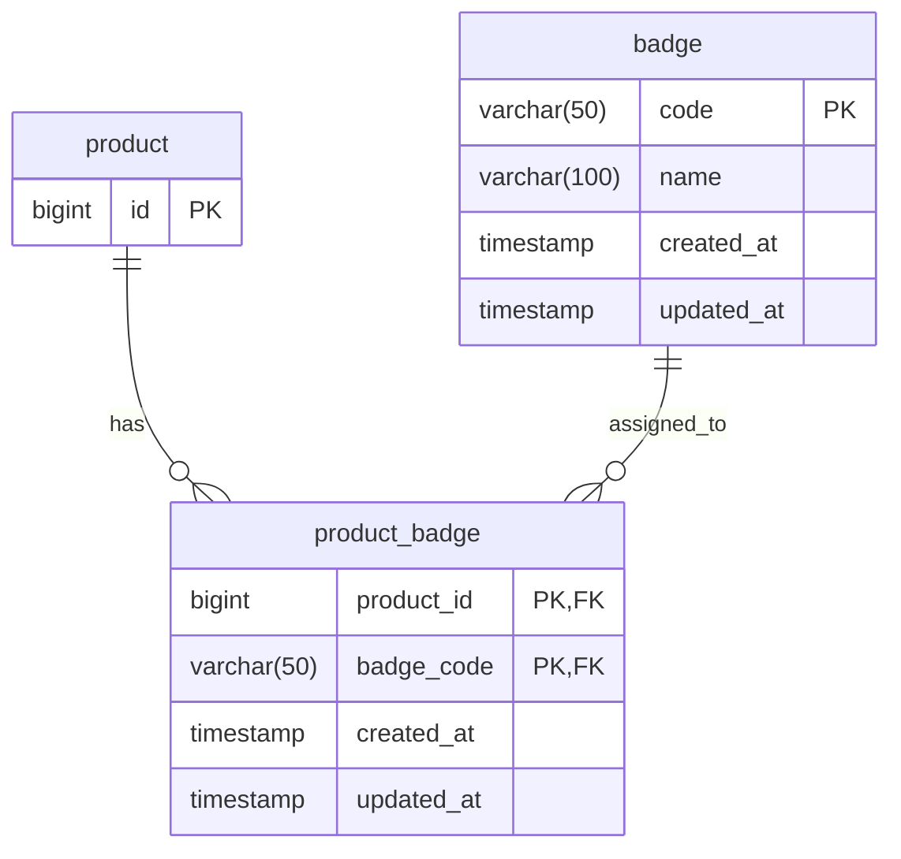

# 제품 배지

배지는 브랜드와 별개의 제품 표시 정보다. 정의는 `badge(code, name)`에, 제품 연결은
`product_badge(product_id, badge_code)`에 저장한다. 코드는 변경하지 않으며 표시명만 수정한다.
이름이 같은 서로 다른 배지를 허용한다. 공백 문자와 빈 코드·이름은 허용하지 않는다.
DB는 `[[:space:]]`, Java는 기본 `\\s`로 공백을 검사한다. 비ASCII 공백에 대한 DB 판정은
DB 로케일을 따르며, Java 조회 모델에서 별도의 Unicode 공백 금지 규칙을 추가하지 않는다.

제품 목록·상세·검색 제안·랭킹·유사 제품·위시리스트·선반 제품 응답은
`badges: [{code, name}]`을 제공하고, 배지가 없으면 `badges: []`다.
큐레이션 상세의 일반 제품(`PRODUCTS`)과 필터별 제품(`PRODUCTS_BY_FILTER`) 응답에는
`badges` 필드를 제공하지 않는다.
배지는 코드의 C 정렬 순서로 반환한다. 배지 필터·검색어 해석·관리 API는 제공하지 않는다.

## ERD

기존 `product`는 연결에 필요한 PK만 표시한다. `product_badge`의 두 FK가 복합 PK이며,
`(badge_code, product_id)` 역방향 검색 인덱스를 둔다.

## 데이터 관리

관리자 API가 구현되기 전까지 운영자가 DB에 직접 접속해 `badge`와 `product_badge`에
데이터를 적재한다. 이번 변경은 테이블과 공개 조회만 제공하며, 관리용 SQL 스크립트나
등록·수정·연결·해제 API는 포함하지 않는다.

마이그레이션은 테이블과 제약만 추가하고 실제 운영 배지·연결 데이터는 넣지 않는다.
제품 표시가 달라지는 데이터를 변경할 때는 기존 카탈로그 저장 계약에 따라 적재하는 쪽에서
영향받는 제품의 `updated_at`도 갱신한다. 수정 시각은 DB 기본값만으로 자동 갱신되지 않는다.
