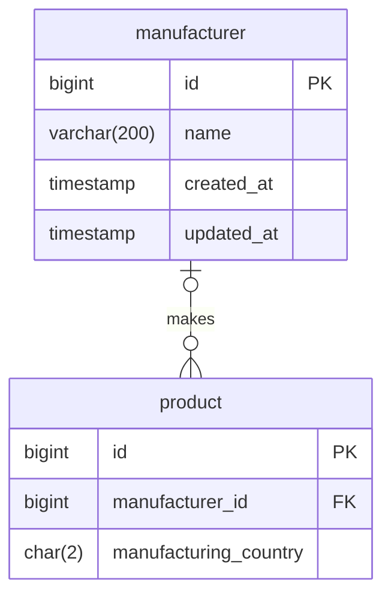

# 제품 제조업체·제조국

제조업체는 `manufacturer(id, name)`에, 제품과의 연결과 제조국은 `product.manufacturer_id`와
`product.manufacturing_country`에 저장한다. 한 제품의 제조업체는 하나다. `id`는 `brand`처럼
적재하는 쪽이 정하고, 이름은 UNIQUE이며 NFC로 저장하고 공백만인 값을 허용하지 않는다. 이름은
상품정보제공고시의 화장품제조업자 표기에서 주소와 책임판매업자를 뺀 회사명이다.

제조국은 ISO 3166-1 alpha-2 코드로 저장하고 `KR`, `AU`, `FR`, `CA`, `US`, `JP`, `GB`, `TH`,
`BE`, `CN`, `CH`만 허용한다. 다른 나라가 필요하면 CHECK를 넓히는 마이그레이션을 추가한다.
두 열 모두 NULL을 허용한다. 고시에 제조업자가 없는 제품이 있고, 고시를 확인하기 전에 제품을
적재할 수 있어야 하기 때문이다.

제조국을 제조업체가 아니라 제품에 두는 것은 같은 제조업체도 제품마다 제조국이 달라서다.
2026-10 운영 제품 기준으로 Estée Lauder Companies는 7개국, 에메이스 코스메틱스는 호주·프랑스,
엘지생활건강과 에버코스는 대한민국·태국에서 만든 제품이 함께 있다. 고시가 제조국을 여러 개
적으면 맨 앞 나라 하나를 저장한다.

API는 아직 이 값을 제공하지 않는다.

## ERD

## 데이터 관리

마이그레이션은 테이블과 제약만 추가하고 운영 제조업체·제품 값은 넣지 않는다. 관리자 API가
생기기 전까지 운영자가 DB에 직접 접속해 `manufacturer`를 적재한 뒤 제품의 두 열을 채운다.
화면에 보이지 않는 값이므로 이 적재만으로는 제품의 `updated_at`을 바꾸지 않는다. 화면에
보여 주게 되면 그때부터 값이 바뀐 제품의 `updated_at`도 함께 갱신한다.
