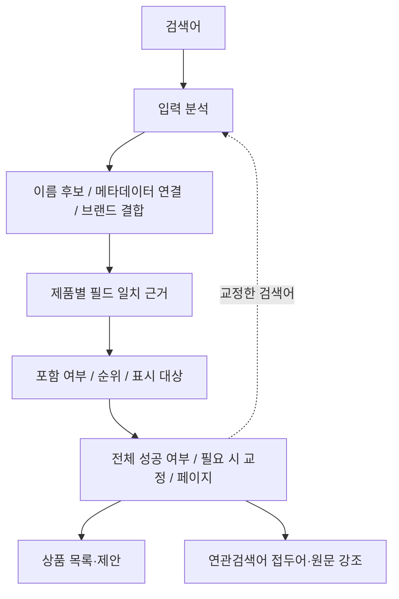

# 제품 검색 읽는 순서

이 문서는 공통 근거를 도입한 **현재 중간 구현**을 설명한다. 전체 단계 분리는 미완료다.
현재 포함·등급·표시 대상 선택은 `search_product_ranked_matches`에 함께 있고,
목록의 요청 필터와 최종 페이지는 Repository에서 처리한다. 아래 흐름은 이 책임들이
완전히 독립된 실행 단계로 분리됐다는 뜻이 아니다.
후속 작업은 [진행 계획과 인계](../exec-plans/active/product-search-evidence-975.md)를 따른다.

제품 검색은 PostgreSQL 안에서 **분석 → 후보 수집 → 일치 근거 → 결과 정책 → 표시** 순서로
처리한다. V46은 각 단계가 주고받는 값을 명시하고 검색·연관검색어의 중복 판정을 없앤다.
정규화는 계속 DB에서 수행한다. Java는 입력·필터·페이지를 전달하고 조회 결과를 응답으로 조립한다.

## 사용자가 검색하면

예를 들어 `닥터지 썬크림 무기자차`를 입력하면 다음 순서로 처리한다.

1. `search_product_analyze()`가 전체 입력과 중복 없는 필수 토큰을 만든다.
   `썬크림`은 등록 표기에 따라 `선크림`으로 바꾸되 원문도 보관한다.
   각 토큰에는 정규형·읽기·초성 여부·표준 표기 적용 여부가 들어간다.
2. `search_product_candidate_ids()`가 기존 MV의 검색 열에서 후보 ID를 찾는다.
   속성값·마크의 현재 연결, 유효한 브랜드·제품명 결합으로 찾은 ID도 후보에 합친다.
3. `search_product_match_evidence()`가 **어느 토큰이 어느 필드에서 맞았는지** 모은다.
   한 제품의 브랜드에서 `닥터지`, 제품명에서 `선크림`, 속성값에서 `무기자차`가 맞으면
   각각의 근거를 남긴다. 다른 제품에서 맞은 토큰을 합쳐 인정하지 않는다.
4. `search_product_ranked_matches()`가 근거를 읽어 결과에 포함할지, 등급과 토큰 비율은
   무엇인지, 제품명·브랜드·메타데이터 중 무엇을 보여줄지 결정한다.
5. `search_product_resolve()`가 전체 결과를 확인한다. 정상 결과가 없을 때만 기존 교정기를
   호출해 같은 경로로 다시 검색한다. 결과를 정렬하고 요청한 페이지의 근거를 넘긴다.
6. 상품 제안은 일치한 원문과 UTF-16 강조 범위를 반환한다. 연관검색어는 저장해 둔 근거로
   브랜드·속성 접두어를 붙이고 강조 범위를 만든다. 브랜드 분할과 필드 검색을 다시 하지 않는다.

## 인덱스와 제품 정책의 경계

`product_search_document`는 제품명·브랜드의 정규형·읽기·초성·표준 표기를 저장한 기존 MV다.
`pg_trgm` GIN 인덱스는 이 열에서 `LIKE`·초성 패턴에 맞을 가능성이 있는 후보를 좁힌다.
ngram을 Java에서 별도 생성하거나 모든 정책을 ngram 비교로 처리하지 않는다.
후보 검색에서 이름을 이어 붙인 문서가 맞더라도, 필드 판정에서 유효한 일치인지 다시 확인한다.
예를 들어 `닥터지`와 `블랙` 사이 경계에 걸친 `지블`은 유효한 브랜드·제품 결합이 아니다.

인덱스는 모든 필수 토큰 충족, 브랜드 결합의 인정 조건, 순위, 교정 시점, 접두어와 강조를
결정하지 않는다. 이 정책들은 아래 함수에 나뉘어 있다. 검색엔진을 쓰더라도 이 정책의 의미와
기대 결과는 별도로 유지해야 한다.

속성값·마크는 `product_search_metadata_term` 일반 뷰에서 **정의를 먼저 찾고 제품 연결을
조회**한다. 이름 MV에 합치지 않으므로 표시명·연결을 바꾼 뒤 검색 MV를 갱신할 필요가 없다.
제품명·브랜드·표준 표기 규칙 변경에는 기존 MV 갱신이 필요하다. V46 자체는 새 MV나 테이블,
인덱스를 만들거나 기존 MV를 갱신하지 않는다. 추가한 복합 타입은 요청 안에서 전달하는 값이다.

## 어디를 고치면 되는가

아래 V46 함수는 `src/main/resources/db/migration/V46__product_search_match_evidence.sql`에 있다.
배포 후 변경은 기존 마이그레이션을 수정하지 않고 새 마이그레이션으로 적용한다.

| 바꾸려는 규칙 | 읽을 곳 | 경계 |
| --- | --- | --- |
| 공백·대소문자·초성·영문 읽기 | 기존 `search_norm`, `search_read_query`, `search_chosung_query` | 저장·입력에 공통 사용 |
| 선크림/썬크림 같은 완성 표기 | 기존 `search_product_spelling_rules`, `search_product_key` | 규칙 교체 후 MV 갱신 |
| 전체 입력·토큰 구성 | `search_product_analyze`, 기존 `search_product_query_tokens` | 원문과 비교 표현을 함께 보관 |
| 인덱스를 통한 이름 후보 | `search_product_candidate_ids` | 필드 의미와 순위를 결정하지 않음 |
| 이름 필드의 일치 | `search_product_name_matches` | 전체 입력과 토큰의 기존 비교 차이 유지 |
| 속성값·마크 일치 | `search_product_metadata_matches` | 정의 검색 후 현재 제품 연결 조회 |
| 붙여 쓴 브랜드+제품 | `search_product_combination_matches` | 가장 좋은 분할과 등급·비율을 함께 반환 |
| 공통 근거 조립 | `search_product_match_evidence` | 위 근거들을 제품 ID로 모음 |
| 필수 토큰·결과 포함·등급 | `search_product_ranked_matches` | `facts → eligibility → accepted → ranked` |
| 상품 제안에 보여줄 필드 | 같은 함수의 `display` | 이름 우선, 메타데이터 표시 순서 보존 |
| 정렬·개수·페이지 | `search_product_evidence_page` | 등급 → 토큰 비율 → 조회수 → 이름 길이 → ID |
| 교정 적용 시점 | `search_product_resolve` | 전체 검색 실패 시 기존 교정기로 재검색 |
| 연관검색어 접두어 | `search_product_related_prefix` | 필드 근거의 일반 일치·초성 일치를 구분 |
| 연관검색어 강조 | `search_product_related_ranges` | 전체 → 토큰 → 결합 → 접두어 순서 |
| 필터·필터 선택지·목록 정렬 | `ProductQueryRepository` | 검색 결과를 관계형 조건과 결합 |

## 호출과 반환 계약

- 상품 목록·개수는 `search_products_v2(query, 0, null, 2)`로 검색 ID와 순위를 받은 뒤
  Repository에서 필터·최종 정렬·페이지·선택지를 함께 계산한다. 검색의 전체 성공 여부를
  먼저 판단하므로 필터로 결과가 없어졌다는 이유로 오타 교정을 시작하지 않는다.
- 상품 제안은 같은 함수를 페이지 크기와 함께 호출해 `matchField`, `matchText`, `matchRange`를 받는다.
- 연관검색어는 `search_product_related_keywords(query, limit, max_length)`를 호출한다.
  상위 결과를 정한 뒤 길이를 제한하는 기존 순서를 유지한다.
- `search_product_queries`, `search_product_metadata_hits`, `search_product_hits`, 기존 core/page는
  호환 호출을 위해 유지한다. 내부 부분 일치 등급 3도 보존하며 HTTP 상품 검색은 최대 등급 2를 사용한다.

`product_search_part`는 분석한 입력, `product_search_field_match`는 필드 일치,
`product_search_combination`은 선택한 분할이다. `product_search_evidence`가 이 값들을
제품별로 묶고 `product_search_ranked_match`가 순위 결과를 더한다. 외부 JSON에 이 내부 타입은 노출하지 않는다.

함수 수와 전체 SQL 줄 수는 줄어들지 않는다. 개선점은 문자열을 여러 번 판정하는 대신
근거를 한 번 만들고 각 정책이 필요한 근거를 읽는다는 데 있다. 읽는 비용이 큰 브랜드 분할과
순위 계산은 여전히 남아 있으며, 정책 자체를 바꾸려면 사례별 기대 결과도 함께 바꿔야 한다.

## 확인할 테스트

`ProductSearchEvidenceTest`는 기존 V43 검색과 새 구현의 결과·순위·전체 개수·페이지·교정·
강조를 비교한다. 필드별 필수 토큰, 선택한 결합 조각, 호출 계획을 재사용한 뒤 규칙을 변경하는
경우도 다룬다. 기존 메타데이터·표기·연관검색어·필터 통합 테스트가 API 계약을 확인한다.
측정 방법과 수치는 [성능 비교](../performance/product-search-975.md)에 기록한다.
